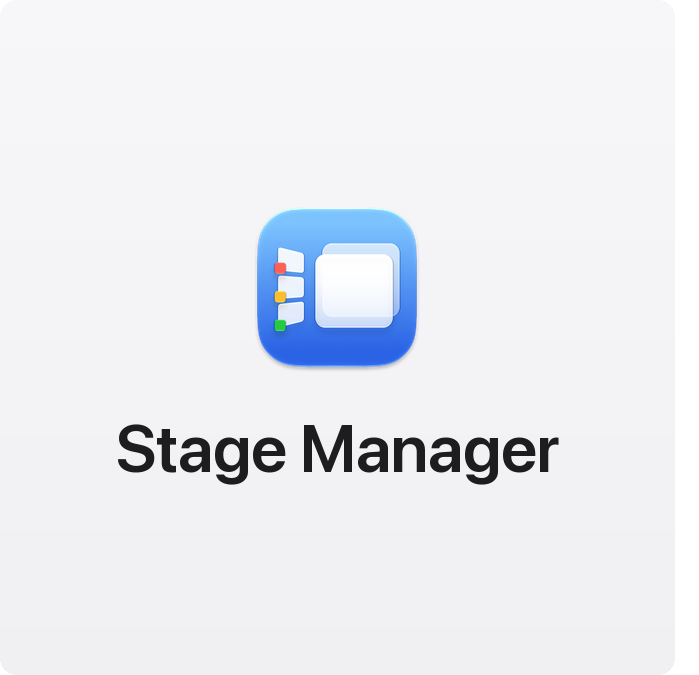
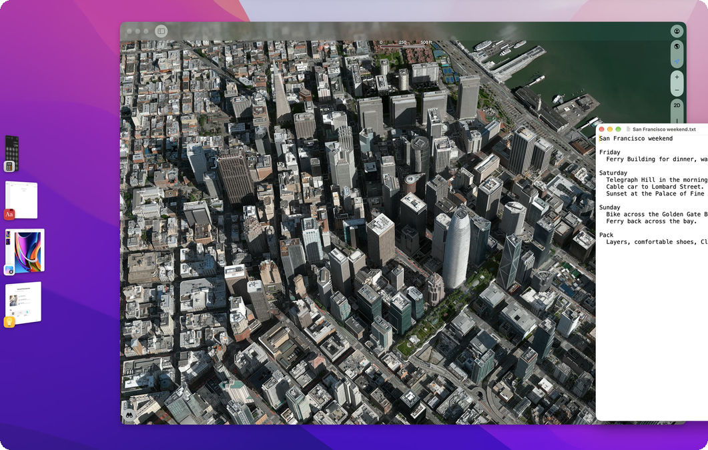
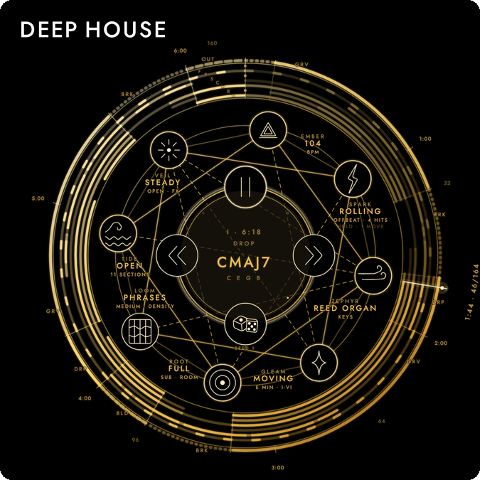
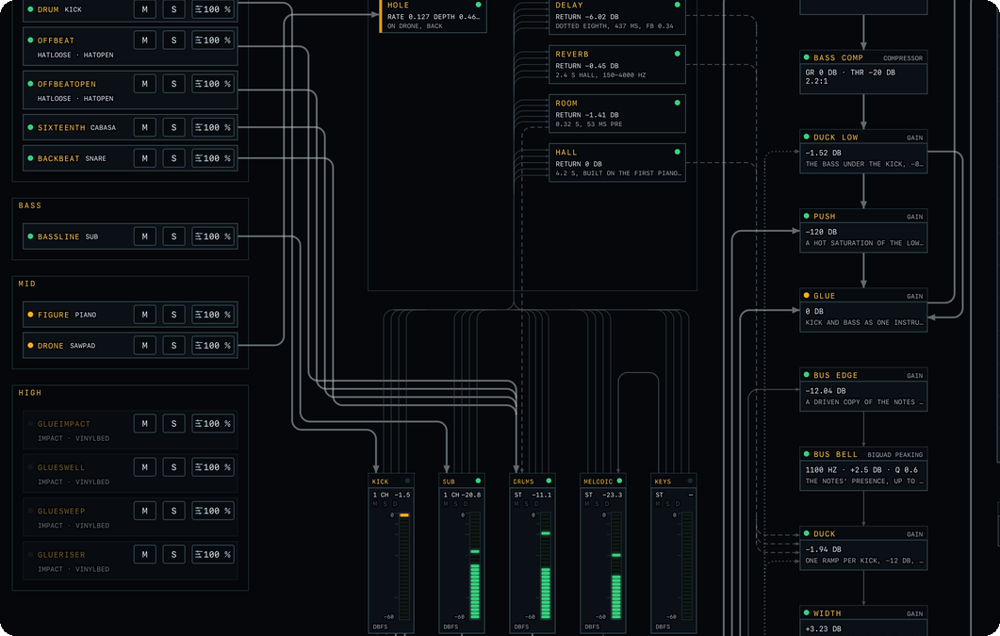
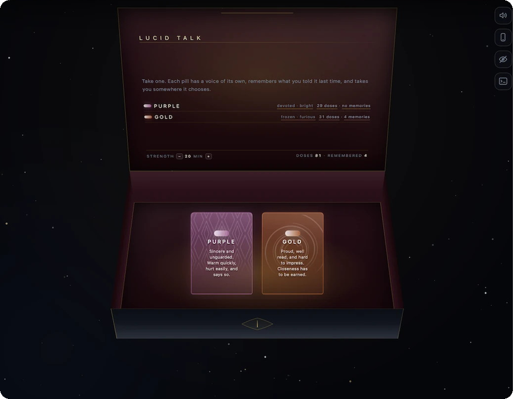
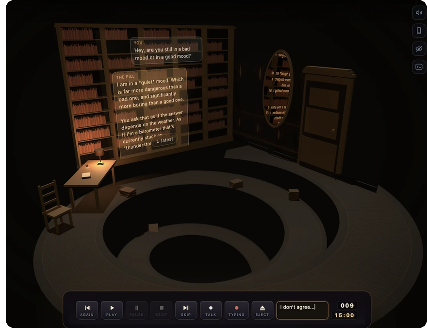
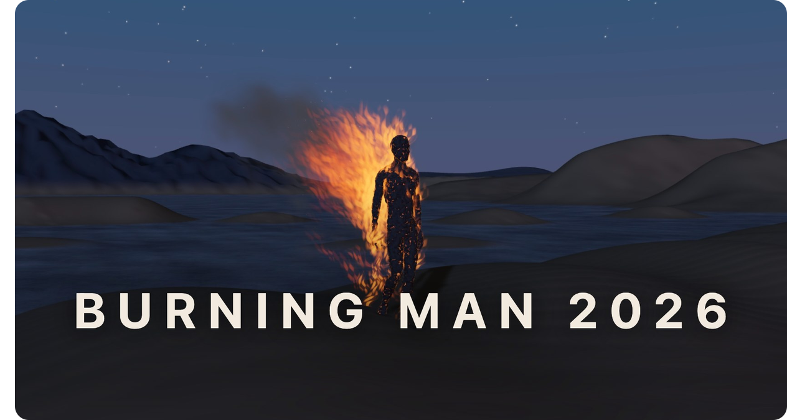

# Eugene T

I am most interested in improving the human experience of interaction with
software. I have endless inspiration for this kind of work.

**Senior Engineering Manager, Frontend Platform & AI at
[Lookout](https://www.lookout.com/)** · San Francisco

```text
      ▁▂▃▄▅▆▆▇▇▇▇▇▆▆▅▄▃▂▁
  ▁▄▆████████▀▀▀▀▀████████▆▄▁
 ▟███▀▀▔▔             ▔▔▀▀███▙
 ███                       ███  Everything
 ▐██▏    ▁▃▅▆▆▇▇▇▆▆▅▃▁    ▕██▌
 ▕██▙▂▄▇█████▀▀▀▀▀█████▇▄▁▟██▏
  ▜████▀▀▔▔         ▔▔▀▀████▛
   ▜█▙                   ▟█▛       Is
    ▜█▙    ▁▄▅▆▆▆▅▄▁    ▟█▛
     ▜██▄▆███████████▆▄██▛
      ▜████▀▔     ▔▀████▛
       ▔███▃       ▃███▔          Okay.
         ▀███▄▁ ▁▄███▀
           ▀▀█████▀▀
              ▔▀▔
```

The React platform and design systems behind Lookout's enterprise security
products, used by Fortune 500 companies and government agencies, with a team
that owns delivery from CI/CD to the cloud. AI-based frontend features
(co-inventor on a published US patent application,
[US 2025/0245371](https://patents.google.com/patent/US20250245371A1/en)) and AI
automation across the engineering workflow and CI.

_React · design systems · Cypress visual testing · AWS · Docker · Jenkins ·
GitHub · multi-platform builds_

### Before

- Senior Staff Software Engineer, Frontend ·
  [Lookout](https://github.com/lookout) · 2015–2022 · _architecture, engineering
  conventions, code reviews_
- Founder · [ShowMap](https://github.com/showmap), an iOS app for festivals and
  art walks · 2014–2015 · _Swift, Xamarin, ASP.NET, Azure Cloud_
- Lead Software Engineer ·
  [HumanConcepts](https://web.archive.org/web/20130116204638/http://www.humanconcepts.com/),
  acquired by Saba · 2010–2015 · _Silverlight, C#, XAML, MVVM_
- Earlier, in Kiev, Ukraine: [EPAM Systems](https://www.epam.com/),
  [Sonopia](https://techcrunch.com/tag/sonopia/),
  [Softline](https://softline.company/en/) · _Adobe Flex, ActionScript, C#,
  ASP.NET_

## After hours

<a href="https://eugene-tea.github.io/stage-manager/"></a><a href="https://eugene-tea.github.io/stage-manager/"></a>

**[Stage Manager](https://eugene-tea.github.io/stage-manager/)**: Apple's Stage
Manager, fixed. Stages survive a restart and keep their place in the strip. They
merge with a drop and split with a drag, new apps open in the current stage, and
no window is lost on a quit or a crash. A native macOS app in Rust.

<br>

<a href="https://deephouse.audio/"></a><a href="https://deephouse.audio/?view=machine"></a>

**[Deep House](https://deephouse.audio/)**: an offline astrolabe for music.
Every voice is synthesized live with Web Audio. It plays on the web and in the
App Store for iPhone, iPad and Mac.

<br>

<a href="https://excelsior-arts.github.io/lucid-dream/talk/"></a><a href="https://excelsior-arts.github.io/lucid-dream/talk/thinker/"></a><a href="https://excelsior-arts.github.io/lucid-dream/trip/burning-man/"></a>

**[Lucid Dream](https://excelsior-arts.github.io/lucid-dream/)**: local 3D and
AI experiences, in three.js with WebGPU. In the browser, the conversations run
on a 2–4B Qwen model through WebLLM. The full experience runs on a Mac with the
27B Qwen through MLX (32 GB). Fully local: no account, no cloud, offline once
the models are downloaded.

<br>

[LinkedIn](https://www.linkedin.com/in/eugenet8k/)
